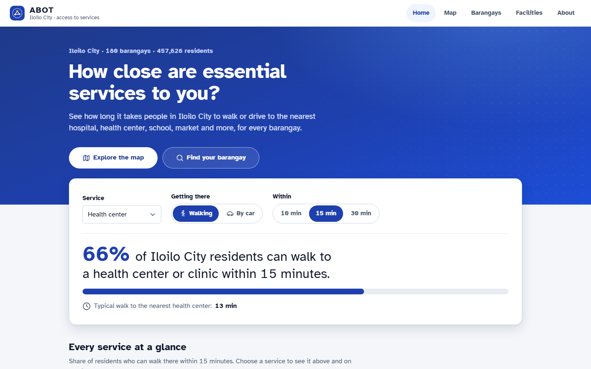
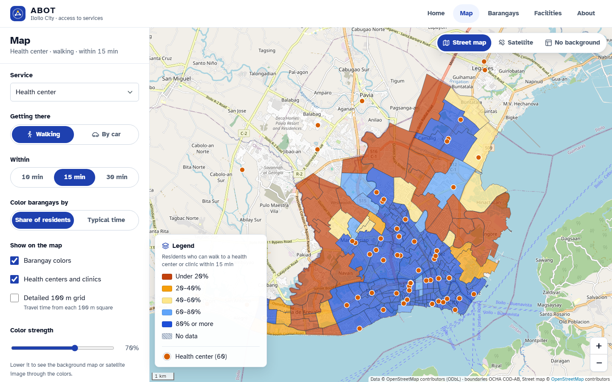
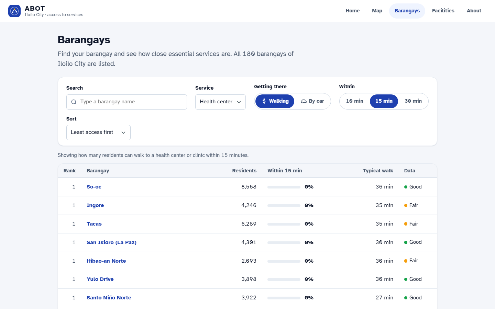
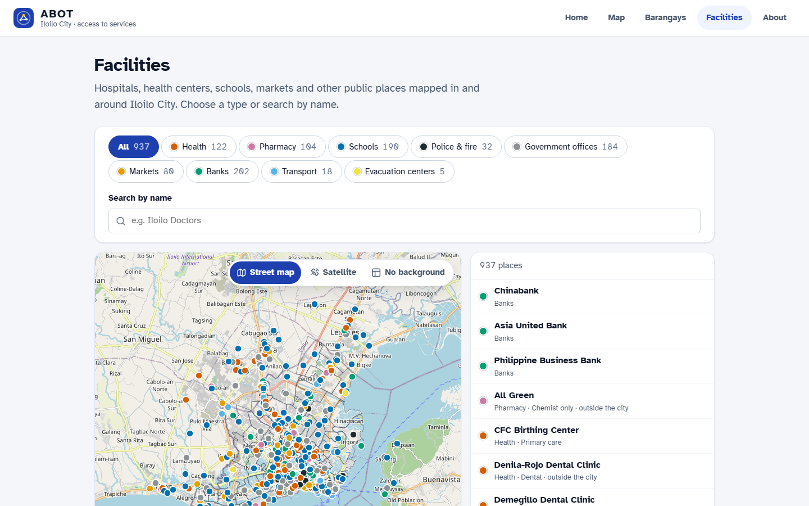
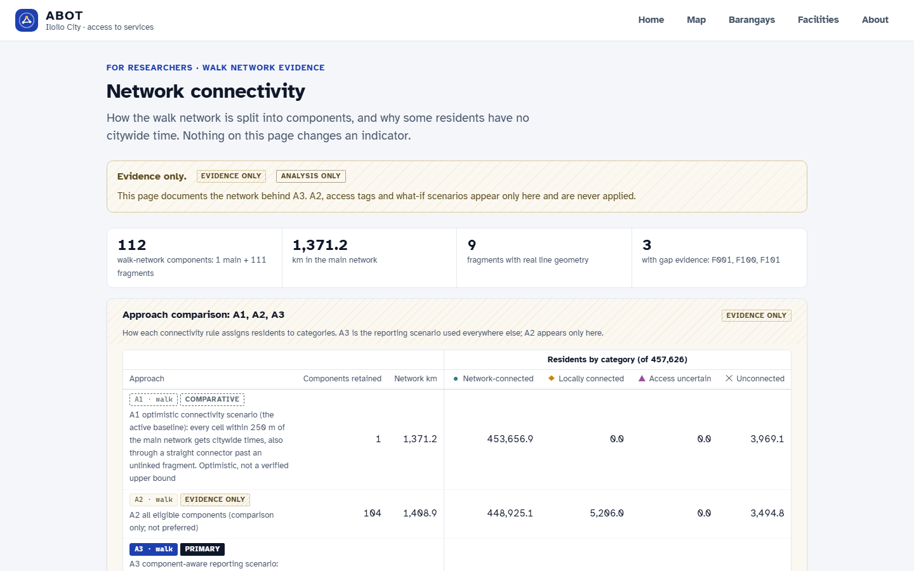
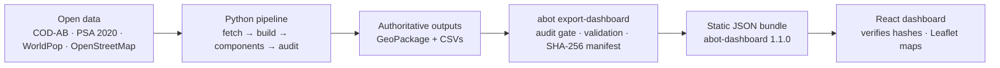

# ABOT

**Geospatial Accessibility and Public Infrastructure Intelligence System**
*Bringing essential services within reach.*

ABOT estimates how long residents of **Iloilo City, Philippines** take to walk or drive to the
nearest hospital, health centre, pharmacy, school, police or fire station, market and bank. It
summarises the results for each of the city's 180 barangays in a static web dashboard. A Python
geospatial pipeline computes every number offline. A React dashboard displays them from a
precomputed, hash-verified data bundle.

ABOT is an independent research and portfolio project. **It is not an official or adopted system of
the Iloilo City Government or any agency.**



## Contents

- [Problem](#problem)
- [Objectives and intended users](#objectives-and-intended-users)
- [Key features](#key-features)
- [Dashboard screenshots](#dashboard-screenshots)
- [Selected findings](#selected-findings)
- [System architecture](#system-architecture)
- [Technology stack](#technology-stack)
- [Repository structure](#repository-structure)
- [Installation requirements](#installation-requirements)
- [Python pipeline: setup and execution](#python-pipeline-setup-and-execution)
- [Dashboard: setup and execution](#dashboard-setup-and-execution)
- [Testing and validation](#testing-and-validation)
- [Data sources and attribution](#data-sources-and-attribution)
- [Methodological limitations](#methodological-limitations)
- [Reproducibility limitations](#reproducibility-limitations)
- [License](#license)

## Problem

Planners need to know which neighbourhoods are far from essential services, but straight-line
distance understates real travel effort. It ignores the street network, rivers and one-way streets.
Official facility registries are also incomplete or not openly licensed. ABOT measures **modelled
travel time along the mapped road and path network**, from where people are estimated to live, to
the nearest **mapped** facility. It reports where the data itself is weak.

## Objectives and intended users

- Estimate walking and driving access to ten groups of essential services for every barangay,
  weighted by where residents live.
- Make data-quality limits visible next to every number: reliability flags, disconnected residents,
  and unverified facility inventories.
- Present the results to residents and barangay or city officials in plain language. A separate
  "For researchers" section covers the methodology, data quality and network evidence.

The indicators are intended for **screening**: finding areas where mapped access looks poor and
deserves field verification. They are not intended for allocating resources on their own.

## Key features

- **Census-anchored 100 m population grid.** PSA 2020 barangay totals spread over WorldPop cells.
  Cells that straddle barangay borders are split by area.
- **Network routing.** Multi-source Dijkstra searches on OpenStreetMap walk and drive graphs.
  One-way streets are respected. Connectors to the network may not cross rivers or the coastline.
- **Component-aware walking analysis (A3).** Residents on network fragments that are cut off from
  the main walk network are classified and reported separately. They are not given optimistic
  citywide times.
- **Explicit denominators.** Shares are always of *all* residents. Residents without a valid
  network connection stay in the denominator and are reported separately.
- **Per-barangay reliability flags** for population, network and facility inventory. Only
  ranking-eligible barangays are ranked.
- **Read-only audit** (`abot audit`) with PASS/WARN/FAIL checks of inputs, staleness and
  consistency. A FAIL blocks the dashboard export.
- **Versioned, verified data bundle.** Contract `abot-dashboard` 1.1.0, with SHA-256 checked at
  export, at build and in the browser. A failed dataset degrades only its own panels.
- **Static dashboard** with eight pages. It needs no server, API or database to run.

## Dashboard screenshots

Captured from the running dashboard (`npm run dev`) with the current bundle, at 1440 × 900.

| Map: share of residents within 15 min walk of a health centre (A3) | Barangays: ranked list (eligible barangays only) |
|---|---|
|  |  |

| Facilities: 937 mapped places by type | Network connectivity: A1 vs A2 vs A3 (for researchers) |
|---|---|
|  |  |

The Data quality page ([screenshot](docs/assets/screenshots/quality.png)) shows the audit result and
known issues. In this bundle it shows `GIT-DIRTY`, because the bundle was exported before the code
was committed. Re-exporting from a clean commit clears it.

## Selected findings

These figures are read from the current dashboard bundle (`city.json`, generated
2026-11-01T01:51:46Z). They describe **modelled** access to **mapped** facilities, not observed
travel or service quality.

**Population.** 457,626 residents (PSA 2020) in 180 barangays. In the A3 walking analysis:

| A3 category | Share of residents |
|---|---|
| Network-connected | 98.08% |
| Locally connected (cut-off fragment) | 1.14% |
| Access-uncertain | 0.02% |
| Unconnected | 0.76% |

**Walking, A3 (primary walking analysis).** Share of *all* residents within the threshold, and the
mean time of residents who have a citywide time:

| Nearest mapped… | Within 15 min | Within 30 min | Mean walk |
|---|---|---|---|
| School (basic education) | 87.4% | 97.9% | 8.6 min |
| Health centre / clinic (primary care) | 66.1% | 90.2% | 13.2 min |
| Pharmacy | 62.2% | 89.9% | 13.8 min |
| Bank | 52.7% | 86.5% | 16.1 min |
| Fire station | 45.9% | 86.5% | 17.2 min |
| Public market | 39.3% | 79.9% | 20.4 min |
| Hospital | 22.6% | 60.4% | 28.0 min |

The **A1** comparative walking analysis gives each value slightly higher, for example hospital
22.9% / 61.2% instead of 22.6% / 60.4%. A1 gives citywide times to residents near cut-off fragments
through a straight connector.

**Driving, A1, free-flow.** 79.6% of residents are within a modelled 10-minute drive of a mapped
hospital. Car times exclude congestion, signals and parking, so they are lower bounds. When the
drive leg is slowed by 1.5× or 2×, the share falls to 55.5% and 38.5%.

**Data quality.**
- 149 of 180 barangays are ranking-eligible (overall reliability: 92 ok, 57 caution, 31 low).
- Four barangays have more than 5% of residents without a network connection. Their indicators are
  flagged: Calahunan 30.7%, Hibao-an Sur 23.7%, Baybay Tanza 6.7%, Tabuc Suba (La Paz) 6.4%.

**Audit at export:** 58 PASS, 3 WARN, 0 FAIL. The warnings are two facility-connection QA notes,
the four barangays above (pending manual review), and 7 possible duplicate facilities pending review.

## System architecture



- All geospatial computation runs **offline** in Python.
- The dashboard is a set of static files that only **displays** the precomputed values.
- The bundle is the only interface between the two.
- There is no API server or database, a deliberate choice for this scope.

[docs/ARCHITECTURE.md](docs/ARCHITECTURE.md) covers each stage, the integrity checks, the known
limits and the design reasoning.

## Technology stack

| Layer | Technologies |
|---|---|
| Geospatial pipeline | Python 3.13, GeoPandas, OSMnx, NetworkX, Shapely, Rasterio, PyProj (through GeoPandas), Pandas, NumPy, SciPy |
| Pipeline outputs | GeoPackage (pyogrio), CSV, Markdown QA report, folium quick-look map |
| Data interface | Versioned JSON/GeoJSON bundle with SHA-256 manifest |
| Dashboard | React 19, TypeScript 7 (strict), Vite 8, Leaflet 1.9 (used directly). Charts are hand-built SVG |
| Tooling | uv (Python environment and lockfile), npm, pytest, Vitest, ruff, `tsc` |
| GIS validation | QGIS for manual review of flagged cells and fragments (`abot review` writes the GeoPackages for it) |

## Repository structure

```
abot/
├── src/abot/              Python package and CLI (`abot`)
│   ├── fetch/             Downloads and provenance manifest
│   ├── boundaries.py      City and barangay polygons
│   ├── population.py      100 m grid, fractional allocation, census anchoring
│   ├── osm.py             Walk/drive graphs, barriers, facilities
│   ├── accessibility.py   Network connection and Dijkstra travel times (A1 baseline)
│   ├── components.py      Walk-network components and the A3 layer
│   ├── reliability.py     Barangay reliability flags
│   ├── audit.py           Read-only PASS/WARN/FAIL audit
│   └── dashboard_data.py  Dashboard bundle exporter and validator
├── config/                settings.yaml and experiment configurations
├── tests/                 pytest suite (250 tests)
├── dashboard/             React + TypeScript + Vite dashboard
│   ├── src/               contract types, loader, models, pages, map
│   ├── test/              Vitest suite (82 tests)
│   └── vite/              bundle plugin (serve in dev, copy and verify at build)
├── docs/                  Architecture, methodology, data sources, contract, audits
├── Documentation.md       Research log and change log
└── data/                  (git-ignored) raw, interim, processed, archive
```

## Installation requirements

| Requirement | Version | Used for |
|---|---|---|
| [uv](https://docs.astral.sh/uv/) | tested with 0.13.6 | Installs Python 3.13 and the pinned dependencies from `uv.lock` |
| Node.js and npm | Node ≥ 22.12 (tested with 24.18.0) | Dashboard |
| Disk | about 1 GB | Source data (about 550 MB download) and outputs |
| Memory | 8 GB RAM, CPU only | The full pipeline |
| Network | Internet access | Downloads, Overpass queries, map backgrounds |

`uv` must be on your PATH for the `uv run …` commands below.

## Python pipeline: setup and execution

```bash
uv sync                          # create .venv with the pinned dependencies

uv run abot fetch                # download boundaries, census and WorldPop (~550 MB) into data/raw
uv run abot build                # boundaries -> population -> osm -> accessibility (A1 baseline)
uv run abot report               # data/processed/qa_report.md and abot_map.html
uv run abot review               # manual-review files (changes no indicator)
uv run abot validate             # desk evidence for review items (Overpass cache only)
uv run abot components           # walk-network components and the A3 reporting layer (offline)
uv run abot audit                # read-only PASS / WARN / FAIL check; exit 1 on FAIL
uv run abot export-dashboard     # write the dashboard bundle to data/processed/dashboard/v1/
```

- **The exporter reads the outputs of every step above.**
- **Optional extra evidence:** `uv run abot fetch-gaps --allow-download` sends one targeted
  Overpass query, about the three network gaps F001, F100 and F101. Run it before
  `abot components`.
  - It never changes an indicator.
  - It adds mapped access tags and gates to the gap evidence on the Network connectivity page.
  - Without it, the gap evidence is reported as `not_examined`.
  - `abot components` records which case applies in `review/m04/snapshot_status.json`. The exporter
    checks that declaration (V-S5): it refuses a snapshot downloaded after `components` ran, or
    left over from another run, and asks you to re-run `abot components`.
- **Fresh clones (no `data/archive/`):**
  - Two checks compare against the author's local archives, which are not distributed: the Milestone
    01 archive check, and the comparison of component classes with the pre-taxonomy reference
    (V-S4).
  - When the whole `data/archive/` directory is absent, both are reported as **not performed**,
    never as passed, and the export can go ahead. The bundle then carries the known issue
    `ARCHIVE-CHECKS-NOT-PERFORMED`.
  - When `data/archive/` exists, both checks are strict.
  - Producing a bundle this way does **not** reproduce the published results (see
    [Reproducibility limitations](#reproducibility-limitations) and
    [docs/M06_2A_REPRODUCIBILITY.md](docs/M06_2A_REPRODUCIBILITY.md) §10).
- Single build stages: `uv run abot build --only population osm`.
- All parameters are in [config/settings.yaml](config/settings.yaml).
- Experiment configurations in `config/experiments/` extend the baseline and write to their own
  folders, for example `uv run abot --config config/experiments/hist_buffer_1km.yaml build`.
- `uv run abot export-dashboard --check` reports whether the bundle is current, without writing.

## Dashboard: setup and execution

The dashboard reads the bundle from `data/processed/dashboard/v1/`, so run the pipeline first.

```bash
cd dashboard
npm ci                # install the exact versions in package-lock.json
npm run dev           # development server; serves the bundle read-only
npm run build         # static site in dashboard/dist/ (bundle copied into dist/data/v1/, hashes checked)
npm run preview       # serve the production build locally
```

- Without a bundle, the build prints a warning and the page shows "no bundle".
- Open the dashboard from `localhost` or over https. Elsewhere, the browser's Web Crypto API is
  unavailable, and the dashboard shows the data as "not verified".
- `dist/` uses relative paths and hash routing (`#/map`), so it can be served from any static host.
  No public deployment exists yet.

## Testing and validation

```bash
# Python
uv run pytest                        # 250 tests; tests that need data/ skip without it
uv run ruff check src tests          # lint

# Dashboard (in dashboard/)
npm test                             # Vitest: 82 tests
npm run typecheck                    # tsc for the app and the build configuration
npm run build                        # production build with bundle verification

# Data
uv run abot audit                    # analytical audit (read-only)
uv run abot export-dashboard --check # bundle staleness (read-only)
```

The 2026-11-02 results of these checks are recorded in the change log of
[Documentation.md](Documentation.md) and in [docs/M06_TECHNICAL_AUDIT.md](docs/M06_TECHNICAL_AUDIT.md).

## Data sources and attribution

No source data is stored in this repository. `abot fetch` downloads it, and
`data/raw/manifest.json` records each file's URL, licence and SHA-256.

| Data | Source | Licence |
|---|---|---|
| Roads, paths, barriers, facilities | © [OpenStreetMap](https://www.openstreetmap.org/copyright) contributors | ODbL 1.0 |
| Administrative boundaries (COD-AB v03) | [OCHA / HDX](https://data.humdata.org/dataset/cod-ab-phl), from NAMRIA and PSA | CC BY-IGO |
| 2020 Census population by barangay | [PSA via HDX](https://data.humdata.org/dataset/popn-single-year-age-sex-and-barangay-census-2020) | CC BY |
| Population counts R2025A, 100 m | [WorldPop](https://hub.worldpop.org/) | CC BY 4.0 |
| Map backgrounds (view time only) | OpenStreetMap tile servers; Esri World Imagery | OSM Tile Usage Policy; Esri terms of use |

- ABOT's outputs that contain OpenStreetMap data, including the dashboard bundle, are derivative
  databases. **If you share them publicly, you must do so under the ODbL**, with attribution.
- Screenshots and maps must credit "© OpenStreetMap contributors".

[docs/ATTRIBUTION.md](docs/ATTRIBUTION.md) lists every data source, tile provider and third-party
library with its licence. Detailed source provenance is in [docs/DATA_SOURCES.md](docs/DATA_SOURCES.md).

## Methodological limitations

- **Modelled, not observed, travel time.** Times are computed on the mapped network under stated
  speed assumptions:
  - walking at 4.5 km/h;
  - driving at assumed free-flow speeds by road class.

  They are not measured trips.
- **Walking and driving are different scenarios.**
  - Walking uses A3 as the primary analysis, with A1 kept as a comparison.
  - Driving uses the A1 network only, and includes the walk to and from the road.
  - Driving times have **no real-time traffic**, congestion, signals, parking or car availability,
    so they are lower bounds. They describe households with a car.
- **Proximity, not service.** The nearest *mapped* facility of a type is measured. Its capacity,
  opening hours, quality or public/private status are not.
- **Unverified facility inventories.** No category has been reconciled with an official registry,
  and a facility missing from OpenStreetMap is a data gap, not proof that the service is absent.
  Evacuation centres, transport, government offices and ATMs are mapped and counted, with no travel
  times.
- **Population.** Barangay totals are PSA 2020 census counts. The distribution *within* a barangay
  is modelled by WorldPop. Small barangays have weak weights.
- **Denominators and connectivity.**
  - Every share uses all residents of the area.
  - Residents without a network connection (A1: 0.87%; A3: 0.76% unconnected) get no time, but
    stay in the denominator.
  - In A3, residents on cut-off fragments (1.14%) or access-uncertain ways (0.02%) get no citywide
    walking time either.
- **Ranking.** Only the **149 ranking-eligible barangays** are ranked. The other 31 have low
  population or network reliability: their values are shown but not ranked.
- **Thresholds** (10/15/30 min walking, 5/10/15 min driving) are analytical reporting thresholds,
  not official service standards.

The full discussion is in [docs/METHODOLOGY.md](docs/METHODOLOGY.md) and
[Documentation.md](Documentation.md) §8.

## Reproducibility limitations

- **Environments are pinned.** `uv.lock`, `package-lock.json` and `.python-version` fix the
  software. All parameters are in `config/settings.yaml`, whose hash is recorded with every output.
- **Builds are deterministic** on the same inputs: byte-identical outputs under different
  `PYTHONHASHSEED` values.
- **A fresh clone does not necessarily reproduce the published numbers.**
  - `data/` is not in Git.
  - The cached OpenStreetMap snapshot (Overpass responses retrieved 2026-10-31) is not distributed,
    and Overpass queries are not pinned to a date.
  - OpenStreetMap changes continuously, so a new fetch, and a new targeted gap query, can give
    different networks and facilities.
  - The manifest records each response's timestamp and SHA-256, so such a difference is
    **detectable**, not avoidable.
  - Distributing the snapshot would have to follow the ODbL.
- **A fresh clone reproduces the method, not a ready-made dashboard.** The dashboard has no data
  until the pipeline has run, and there is no hosted demo yet.

## License

The ABOT source code is released under the [MIT License](LICENSE). Copyright © 2026 Carl John L.
Coopera.

The MIT License covers the code only:
- Data downloaded or derived by the pipeline keeps its own licence: ODbL 1.0 for
  OpenStreetMap-derived outputs, Creative Commons for the other sources.
- Third-party libraries, fonts and map tiles keep their own licences.

See [docs/ATTRIBUTION.md](docs/ATTRIBUTION.md).
