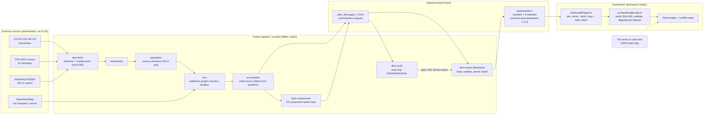

# ABOT architecture

This document explains how ABOT is built: what each part does, where data flows, and why the system
is designed this way. It describes the code as it is at Milestone 06.1. Method details are in
[METHODOLOGY.md](METHODOLOGY.md), and the dashboard data format is specified in
[DASHBOARD_DATA_CONTRACT.md](DASHBOARD_DATA_CONTRACT.md).

## 1. System overview

ABOT has two parts that never run at the same time and share exactly one interface:

| | Analytical pipeline | Dashboard |
|---|---|---|
| Location | `src/abot/` (Python package, CLI `abot`) | `dashboard/` (React 19, TypeScript, Vite) |
| Runs | Offline, on the analyst's machine, in batch | In the reader's browser |
| Does | Downloads source data, builds the population grid and networks, computes travel times, audits the outputs, exports the bundle | Loads and verifies the bundle, then shows maps, tables and charts |
| Computes indicators? | Yes, all of them | **No.** It only displays precomputed values |
| Output / input | `data/processed/` (GeoPackage, CSVs) and the bundle `data/processed/dashboard/v1/` | The bundle, copied into the static build |

The interface between them is the **dashboard data bundle**: a versioned set of JSON and GeoJSON
files with a SHA-256 manifest, defined by the contract `abot-dashboard` 1.1.0. The frontend never
reads the GeoPackage or CSVs, and never imports Python output files directly.

**Analytical processing and web serving are separate.** All geospatial computation (network
routing, spatial joins, raster windowing) happens once, offline, in Python. The dashboard is a set of
static files that any web server or static host can serve. There is no application server, no API
and no database at runtime.

## 2. Analytical pipeline

The pipeline is a command-line program (`src/abot/cli.py`). Its stages read from and write to fixed
folders under `data/`, which is git-ignored.

| Command | Module(s) | Writes |
|---|---|---|
| `abot fetch` | `fetch/common.py`, `fetch/sources.py` | `data/raw/` and `data/raw/manifest.json` |
| `abot build` | `boundaries.py` → `population.py` → `osm.py` → `accessibility.py` | `data/interim/`, `data/processed/abot_iloilo.gpkg`, CSVs |
| `abot report` | `report.py` | `qa_report.md`, `abot_map.html` (folium quick-look map) |
| `abot review`, `abot validate` | `review.py`, `validation.py` | Manual-review and desk-evidence files under `data/processed/review/` (no indicator changes) |
| `abot components` | `components.py`, `access.py` | The A3 layer in `data/processed/component_aware/`; verifies the baseline files are unchanged |
| `abot audit` | `audit.py` | Nothing (console only; `--output FILE` outside `data/`) |
| `abot export-dashboard` | `dashboard_data.py` | Only `data/processed/dashboard/` |

**Configuration.** Every parameter (categories, speeds, tolerances, thresholds, paths) is in
`config/settings.yaml`, loaded by `config.py`. A SHA-256 of the resolved configuration is recorded
with every stage, so outputs built with a different configuration are detected. Experiments in
`config/experiments/*.yaml` `extends:` the baseline and write to their own `data/processed/<run>/`
folder, never over the baseline.

**Coordinate system.** All distances and areas are computed in WGS 84 / UTM zone 51N (EPSG:32651).
The bundle is written in WGS 84 longitude and latitude for web display.

## 3. Geospatial data ingestion

- **Fixed-file sources** (COD-AB GeoDatabase, PSA census workbook, WorldPop GeoTIFFs) are found
  through the HDX CKAN API or a URL template. They are streamed in 1 MiB chunks to a `.part` file,
  which is renamed once complete. The URL, retrieval time, size, licence and SHA-256 are recorded in
  `data/raw/manifest.json`. A cached file is reused if its size matches the server's
  `Content-Length`.
- **OpenStreetMap** is queried live through Overpass by osmnx, for the city polygon plus a 3 km
  extraction buffer (so facilities and paths just outside the city count). Responses are cached in
  `data/raw/osm_cache/`. Each response's `timestamp_osm_base`, SHA-256 and query are recorded, so a
  changed snapshot is detectable, but the queries are not pinned to a date (see §10).
- **Memory.** The national boundary file and the national WorldPop rasters are read through spatial
  filters and raster windows, so the pipeline runs on an 8 GB, CPU-only laptop. A full build from
  the cache takes about 40 s.

## 4. Population grid and census anchoring

`population.py`:
1. Windows the WorldPop R2025A 100 m rasters (2020 and 2026; same grid, checked) to the city and
   keeps every cell that touches it with a positive count. One cell is about 92.6 m × 91.0 m.
2. **Fractional allocation:** each cell square is split between the barangays it overlaps in
   proportion to area (`pop_pieces`). The part outside the city is dropped.
3. **Census anchoring:** within each barangay, the WorldPop 2020 piece values are scaled so the
   barangay total equals its PSA 2020 census count. Barangay totals are therefore observed; only
   the pattern *within* a barangay is modelled. The original WorldPop values are kept beside the
   weights.
4. The cell centre is the origin point for routing. The city total is 457,626 residents (PSA 2020).

WorldPop R2025A was itself built from this census, so the agreement between the two is not used as
validation ([METHODOLOGY.md](METHODOLOGY.md) §7).

## 5. Road network preparation and component analysis

`osm.py` builds two graphs with osmnx:
- **Walk:** the osmnx `walk` network, bidirectional, at 4.5 km/h.
- **Drive:** the osmnx `drive` network, respecting `oneway`, reduced to its largest strongly
  connected component. Speeds are assumed free-flow urban speeds by road class. A tagged `maxspeed`
  can only lower them (policy `cap`).
- **Barriers:** water areas, rivers, canals, streams and the coastline are extracted, so that a
  straight connector from a home to the network cannot cross water.

**Component analysis** (`components.py`, Milestone 04). The walk fetch has 112 weakly connected
components: one main network (1,371.2 km) and 111 fragments. The baseline keeps only the largest
component, so some residents near a fragment are joined to the main network by a long straight
connector. `abot components` classifies every fragment (separated by water, restricted access,
access-uncertain, dead end, geometry error, isolated local network, small fragment) and builds an
additional reporting layer:

| Scenario | Rule | Role in ABOT |
|---|---|---|
| **A1** | Largest component only; every cell within 250 m of it gets citywide times | The pipeline baseline. **Comparative walking analysis** and the source of all **driving** indicators. Optimistic, not a verified upper bound |
| **A3** | Residents are network-connected, locally connected (on an isolated fragment), access-uncertain or unconnected; only network-connected residents get citywide walking times | **Primary walking analysis** in the dashboard |

A3 never adds links between components and never overwrites the baseline. `abot components` checks
the baseline file hashes before and after, and `abot audit` checks that A1 still reproduces the
baseline.

## 6. Facility processing

`osm.py` fetches every OSM feature whose tags match one of nine categories (health, pharmacy,
education, safety, government, market, finance, transport, evacuation):
- Polygons are reduced to an interior point, and all tags are kept.
- Ordered sub-type rules in `settings.yaml` assign each feature a sub-type with a **reporting tier**:
  - *indicative*: gets travel times;
  - *descriptive*: mapped and counted only;
  - *excluded*.
- A feature belongs to every category it matches (`facility_roles`).
- Points inside a polygon of the same category are merged. Possible duplicates (same name, within
  50 m) are flagged for manual review, never merged automatically. Everything removed is listed with
  a reason in `facility_exclusions.csv`.
- Travel times are computed for ten **indicator groups** of indicative sub-types:
  - hospitals, primary care, pharmacies;
  - basic and higher education;
  - police, fire stations;
  - public markets, supermarkets;
  - banks.

No category has been verified against an official registry.

## 7. Accessibility computation

`accessibility.py`:
1. **Connection.** Each cell centre and facility is joined by a straight connector to the nearest
   point on a walk edge (the edge interior, not its end node). A connector is rejected if it crosses
   water. The tolerances are 250 m for cells and 500 m for facilities. Points with no acceptable edge
   are **not connected**: they get no travel time, but stay in every denominator and are reported
   separately.
2. **Walking time.** For each indicator group, one multi-source Dijkstra search on the reversed walk
   graph gives every node its time to the nearest destination (one search per group, not per
   facility).
3. **Driving time.** The walk to and from the car is routed on the walk network. The drive leg is a
   Dijkstra on the reversed drive graph, so one-way streets are respected. The result is door-to-door,
   **free-flow** time, with no congestion, signals or parking.
4. **Aggregation.** Cell times are aggregated to population-weighted barangay indicators:
   - mean and 90th percentile, over connected residents;
   - share within 10/15/30 min walking or 5/10/15 min driving, over **all** residents.
5. **Reliability.** `reliability.py` flags each barangay's population and network reliability.
   Barangays where either is *low* are not ranking-eligible (149 of 180 are eligible).

The routing was checked against independent implementations on random samples. The results agree
within 0.005 min ([METHODOLOGY.md](METHODOLOGY.md) §5.4).

## 8. Dashboard data export and validation

`abot export-dashboard` (`dashboard_data.py`) turns the authoritative outputs into the bundle:

1. **Audit gate.** `abot audit` runs in-process first, and a FAIL blocks the export.
   `--skip-audit` is possible, but it is then recorded as `not_run`, never as passed.
2. **Build.** It reads the outputs read-only and writes eight datasets:
   - `city.json`: citywide indicators and the walking-time distribution;
   - `barangays.geojson`;
   - `barangay_indicators.json`;
   - `cells-NNN.geojson`: 8,035 cells in equal-count chunks under 4 MB each;
   - `facilities.geojson`;
   - `network.json`;
   - `provenance.json`;
   - `manifest.json`, which lists each file's size and SHA-256, the source files' hashes, the
     configuration hash, the stage times and the Git commit.

   Every value carries its scenario (A1/A3) and role (primary, comparative, evidence only). JSON is
   compact, deterministic and NaN-free.
3. **Independent validation.** The written files are re-read and re-checked against the sources.
   This includes an independent recomputation of the walking-time distribution.
4. **Atomic install.** The bundle is written to a temporary folder, validated, and only then swapped
   into `dashboard/v1/`. An interrupted run can be recovered automatically.
5. **`--check`.** Reports whether the bundle is still current (sources, configuration, stage times,
   file hashes) without writing anything.

**Optional evidence input.** `abot fetch-gaps --allow-download` sends one targeted Overpass query
about the three walk-network gaps. It feeds only the gap evidence, never an indicator.
- `abot components` declares whether it used such a snapshot (`review/m04/snapshot_status.json`).
- The exporter follows that declaration and refuses any mismatch (check V-S5, since contract 1.0.1).
- Without a snapshot, the gap evidence is exported as `not_examined`.

## 9. Frontend loading and visualization

- **Development and build** (`dashboard/vite/bundlePlugin.ts`):
  - In development, the plugin serves the bundle read-only from `data/processed/dashboard/v1/`. Only
    plain `*.json`/`*.geojson` names are served, so there is no path traversal.
  - At build time, it copies the bundle into `dist/data/v1/` and re-checks every file's size and
    SHA-256 while copying.
- **Loading** (`src/data/loadBundle.ts`):
  - It loads, in order: the manifest, a contract-version compatibility check, each file's size and
    SHA-256 (Web Crypto), the dataset envelope, cell-chunk reconstruction, and structural
    validation.
  - A failed manifest or `city.json` is fatal. Any other failed dataset is marked unavailable with
    its reasons while the rest of the dashboard works. The cell layer is complete or disabled,
    never partial.
  - Without Web Crypto (pages not served from https or localhost), sizes are still checked and a
    visible "not verified" state is shown.
- **Views:**
  - Five public pages: Home, Map, Barangays, Facilities, About.
  - Three pages for researchers: Methodology, Data quality, Network connectivity.
  - Leaflet is used directly (`src/map/leaflet.ts`, loaded on first use), not through a React
    wrapper. Charts are hand-built SVG and HTML, with no chart library.
  - Routing uses the URL hash (`#/map`) with relative asset paths, so the build works from any
    folder of any static host.
- **Background map** (optional): the OpenStreetMap street map, loaded from the OSM tile servers at
  view time. Satellite imagery (Esri) was removed in M06.3 for licensing.
  "No background" contacts no server.

## 10. Reproducibility and provenance

| Element | Mechanism |
|---|---|
| Python environment | `uv.lock` (38 packages), `.python-version` 3.13 |
| Frontend environment | `package-lock.json`, exact versions in `package.json` |
| Parameters | `config/settings.yaml`, its SHA-256 recorded per stage |
| Fixed-file inputs | URL, licence and SHA-256 in `data/raw/manifest.json` |
| OSM snapshot | Overpass `timestamp_osm_base` and SHA-256 per cached response |
| Determinism | Byte-identical outputs under different `PYTHONHASHSEED` values (recorded in Documentation.md §9) |
| Superseded outputs | `data/archive/<name>/` with SHA-256 records verified by `abot audit` |
| Shipped bundle | `manifest.json`: file hashes, source hashes, configuration hash, Git commit and whether the working tree was clean |

**Limit:** `data/` is not in Git and the OSM cache is not distributed. Overpass queries are not
pinned to a date, so a fresh clone reproduces the **method** but not necessarily the **published
numbers**: OpenStreetMap changes continuously. The manifest makes such a difference detectable, but
not avoidable.

**Archive-aware validation** (contract 1.1.0). Two checks compare against the author's local
archives in `data/archive/`, which are not distributed:
- the audit's `m01_archive_present` and the SHA-256 checks of archived outputs;
- the exporter's V-S4 comparison of component classes with the pre-taxonomy reference.

When `data/archive/` exists, they are strict: a missing reference or a failed comparison blocks
the export. When the whole directory is absent, as in a fresh clone:
- they are reported as **NOT PERFORMED** (an audit WARN, and `component_classes_check.status:
  not_performed`), never as passed;
- the bundle carries the known issue `ARCHIVE-CHECKS-NOT-PERFORMED`.

Such a bundle does not show that historical results were reproduced
([M06_2A_REPRODUCIBILITY.md](M06_2A_REPRODUCIBILITY.md) §10.4).

## 11. Known architectural limitations

1. **Everything loads up front.** The browser downloads and hashes about 10.2 MB of data before the
   first page appears. The two cell chunks are about 3.5 MB each. This is fine on desktop and slow on
   weak mobile connections.
2. **Precomputed results only.** There is no query for an arbitrary point, and no "what if a clinic
   were added here". Any change means re-running the pipeline, re-exporting and redeploying.
3. **One city, one snapshot.** The bundle path is `v1/`, with no catalogue of several cities or
   dates.
4. **No published demo yet.** `data/` is git-ignored, so a fresh clone builds a dashboard that
   reports "no bundle" until the pipeline has been run.
5. **Third-party tiles.** The street-map background depends on the OSM tile servers and their
   usage policy.
6. **ODbL.** The bundle is a derivative of OpenStreetMap data. Publishing it means publishing it
   under the ODbL ([ATTRIBUTION.md](ATTRIBUTION.md), [LICENSE-DATA.md](../LICENSE-DATA.md)).

## 12. Why there is no API server or database

FastAPI, PostgreSQL and PostGIS were assessed against ABOT's actual requirements
([M06_TECHNICAL_AUDIT.md](M06_TECHNICAL_AUDIT.md) §3.7) and are not used:

| Requirement | Static bundle (current) | API server + database |
|---|---|---|
| Serve fixed, audited results for 180 barangays | Static files; any host; nothing running | Same answers, plus hosting, uptime and security work |
| Integrity and provenance | SHA-256 checked at export, build and load | Would need its own equivalent checks |
| Spatial analysis | GeoPandas, Shapely and NetworkX in batch; routing is the expensive step | PostGIS does not route on OSM graphs better here; pgRouting would be a rewrite |
| Reproducibility | Files, lockfiles and a versioned contract | Database state is harder to version |
| Cost of a portfolio demo | Free static hosting | Needs a running server |

A server or database would be justified only by a **new** requirement, such as:
- interactive scenarios (adding a facility and re-routing);
- several cities or dates queried on demand;
- user-submitted corrections;
- data too large to send to the browser.

None of these is in scope.
